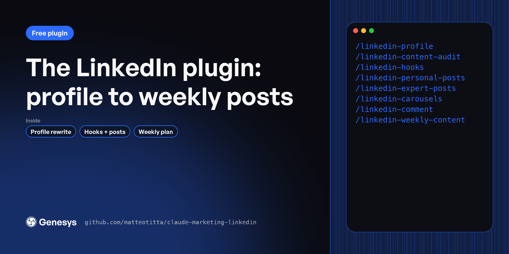

# LinkedIn plugin

Posting every week is hard when every draft starts from a blank page. These 8 skills fix your profile, find what already works, and draft hooks, posts, carousels and comments in your own voice, planned a week at a time. For founders and marketers building a personal brand on LinkedIn.

**Free, MIT licensed. Works in Claude Code, Claude.ai and Cowork.**

---

## Install

In Claude Code:

```
/plugin marketplace add matteotitta/claude-marketing-linkedin
/plugin install marketing-linkedin@claude-marketing-linkedin
```

From your terminal:

```bash
claude plugin marketplace add matteotitta/claude-marketing-linkedin
claude plugin install marketing-linkedin@claude-marketing-linkedin
```

In Claude.ai or Cowork: download [`claude-marketing-linkedin.zip`](https://github.com/matteotitta/claude-marketing-linkedin/releases/latest) and upload it under *Customize → Plugins → Upload plugin*.

---

## Skills

| Skill | What it does |
|---|---|
| `/linkedin-carousels` | Plans a LinkedIn carousel people finish reading. |
| `/linkedin-comment` | Writes LinkedIn comments on other people''s posts that read human and build relationships with buyers and the people they follow. |
| `/linkedin-content-audit` | Audits the recent posts of one or more LinkedIn creators. |
| `/linkedin-expert-posts` | Writes authority LinkedIn posts in the author''s voice: contrarian takes, frameworks, industry analysis, expert breakdowns and predictions. |
| `/linkedin-hooks` | Writes LinkedIn post hooks (the first one or two lines) aimed at a specific buyer and offer. |
| `/linkedin-personal-posts` | Writes personal LinkedIn posts in the author''s own voice. |
| `/linkedin-profile` | Audits a LinkedIn profile and rewrites the copy so it speaks to one buyer and earns the click. |
| `/linkedin-weekly-content` | Plans and drafts a week of LinkedIn posts in two stops. |

**Start here:** `/linkedin-profile → /linkedin-content-audit → /linkedin-weekly-content`

---

## Works best with your context

Every skill reads your context files before it writes: `context/icp/`, `context/positioning/`, `context/messaging/`, `context/brand/` and the rest. If a file is missing, the skill asks you or tells you what it's working without.

The quickest way to set those folders up is a free workspace template:

- [repo-structure-in-house](https://github.com/matteotitta/repo-structure-in-house) for one company
- [repo-structure-agency](https://github.com/matteotitta/repo-structure-agency) for agencies and consultants (swap `context/` for `clients/<client>/context/`)

---

## What the full version adds

These are free, shortened versions of skills from [Marketing Engineering University](https://maven.com/matteo-tittarelli/marketing-engineering-university-genesys-growth). The course versions add the reference material, worked examples and output templates these leave out, plus agents and hooks that chain the skills and check their own work. Week 3 of Marketing Engineering University turns your week into a skill chain you review from your phone.

## More free plugins

- [Marketing context plugin](https://github.com/matteotitta/claude-marketing-context)
- [Product launch plugin](https://github.com/matteotitta/claude-marketing-launch)
- [Website plugin](https://github.com/matteotitta/claude-marketing-website)
- [AEO plugin](https://github.com/matteotitta/claude-marketing-aeo)
- [Content plugin](https://github.com/matteotitta/claude-marketing-content)
- [Build your own GTM skills](https://github.com/matteotitta/gtm-skill-template)

---

Built by [Matteo Tittarelli](https://www.linkedin.com/in/matteotittarelli/) at [Genesys Growth](https://genesysgrowth.com). MIT licensed.
